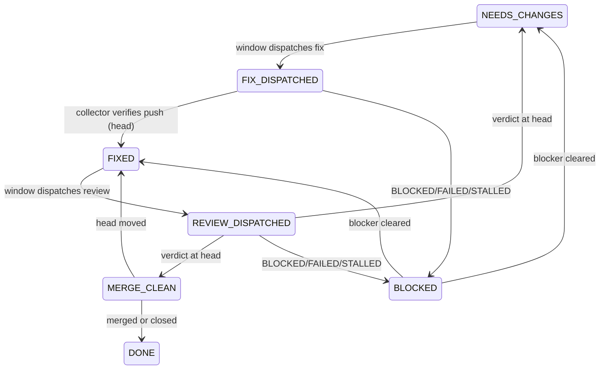

# Burn window

**Layer:** **`burn-window`** → `dispatch` → `review-fix-loop` (inside the implementer thread).

A window is one scheduled run that spends available model quota on queued MR work. This skill owns scheduling, menu state and priority. Launching, probing, collecting and verifying belong to the `dispatch` skill; review rounds to `review-fix-loop`. Fleet values (`<HOST>`, models, `<MENU>`, lock path, concurrency cap): the `dispatch` skill's `references/ar-3.md`.

Only `<OPERATOR>` decides strategy; the window executes the menu.

## The menu

`<MENU>` holds one line per item:

```
- [ ] <tier> <repo>!<iid> <STATE> head=<sha|-> owner=<tmux-session|-> | <ISO time> <outcome>
```

`<tier>` is `fix`, `review` or `issue` (issue lines use `<repo>#<iid>`). A `## Eligible issues` section lists the issues `<OPERATOR>` has cleared for new work; nothing else is eligible.



The window may make every transition above except `BLOCKED → *` for non-quota blockers, which need `<OPERATOR>`. Step 3 may also overwrite any state with what GitLab shows (merged or closed → `DONE`; a verdict at the current head → its state). When an issue thread opens an MR, add a `review` line in state `FIXED` with `owner` = the implementer session (its `review-fix-loop` owns the reviews) and mark the issue line `DONE`.

## Step 1: Take the lock

`exec 9>"<WINDOW_LOCK>"; flock -n 9 || exit 0`. A busy lock means the previous window is still running: exit silently. Hold the lock until Step 5.

## Step 2: Probe

Probe `<IMPLEMENTER_MODEL>` and `<REVIEWER_MODEL>` per the `dispatch` skill (Step 4, probe). Both can wall.

| Implementer | Reviewer | This window |
|---|---|---|
| live | live | dispatch everything ready |
| live | limited | fix and issue work only |
| limited | live | reviews only; treat silent running implementer threads as suspect and verify them (Step 3) before declaring them lost |
| limited | limited | no dispatch; report quota-blocked at close |

Limit without a reset time → record `retry: next window` and continue.

## Step 3: Reconcile the menu with GitLab

GitLab is the source of truth; fix `<MENU>` before dispatching anything. For each MR line, read the API `sha`, `state` and latest verdict note (first line names the head, per `review-fix-loop`):

- Merged or closed → `DONE`.
- `owner` session alive → skip the line this window.
- `owner` set but dead → read its dispatch record, verify delivery per `dispatch` Step 6 for the record's `kind`, apply the resulting transition, clear `owner`.
- Verdict at the current head → its state (`NEEDS_CHANGES` or `MERGE_CLEAN`), whatever the menu says.
- No verdict at the current head (head moved, or none yet) → `FIXED`.

The menu is never exhausted while any `NEEDS_CHANGES` line stands.

## Step 4: Dispatch in priority order

1. **Fix** — `NEEDS_CHANGES` lines → `<IMPLEMENTER_MODEL>`, brief says to fix the verdict items and run `review-fix-loop` after pushing.
2. **Re-review** — `FIXED` lines → `<REVIEWER_MODEL>` with the `review-fix-loop` reviewer template, one round.
3. **Issue** — only when tiers 1–2 are empty: issues in `## Eligible issues` with no related MR → `<IMPLEMENTER_MODEL>`, new MR, `review-fix-loop` after pushing.

Each dispatch follows the `dispatch` skill, Steps 1–5, including the collector; record `kind: implement` for Fix and Issue lines, `kind: review` for Re-review lines. Set `owner=<session>` and the `*_DISPATCHED` state the moment the session launches. Stop dispatching when live model sessions on `<HOST>` reach the fleet concurrency cap; the rest waits for the next window.

## Step 5: Close

1. Write outcomes and ISO timestamps to `<MENU>`; reap sessions whose delivery Step 3 verified.
2. Report only meaningful change (a verdict, a merge, a new blocker) in one paragraph: `<n> dispatched; <MR: verdict, …>; <blockers>`. No meaningful change → no report.
3. Release the lock.

## Failure modes

| Incident | Rule |
|---|---|
| Hung probes reported as outages | Step 2 bounded probe |
| Menu declared exhausted while NEEDS CHANGES verdicts stood | Step 3 reconcile |
| Two implementers pushing one branch | Step 3 owner check, Step 1 lock |
| Implementer threads assumed quota-proof | Step 2 probes both models |
| Windows wasted on dispatch spam | Step 5 silence rule |
| Unsanctioned issue work | Step 4 eligible-issues allowlist |
